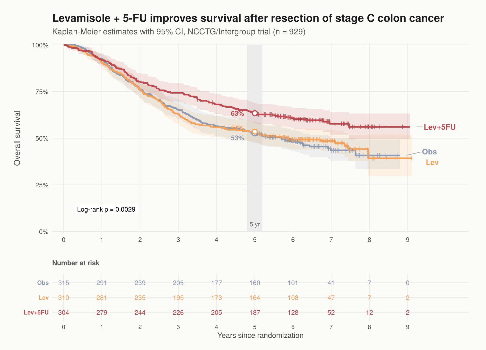
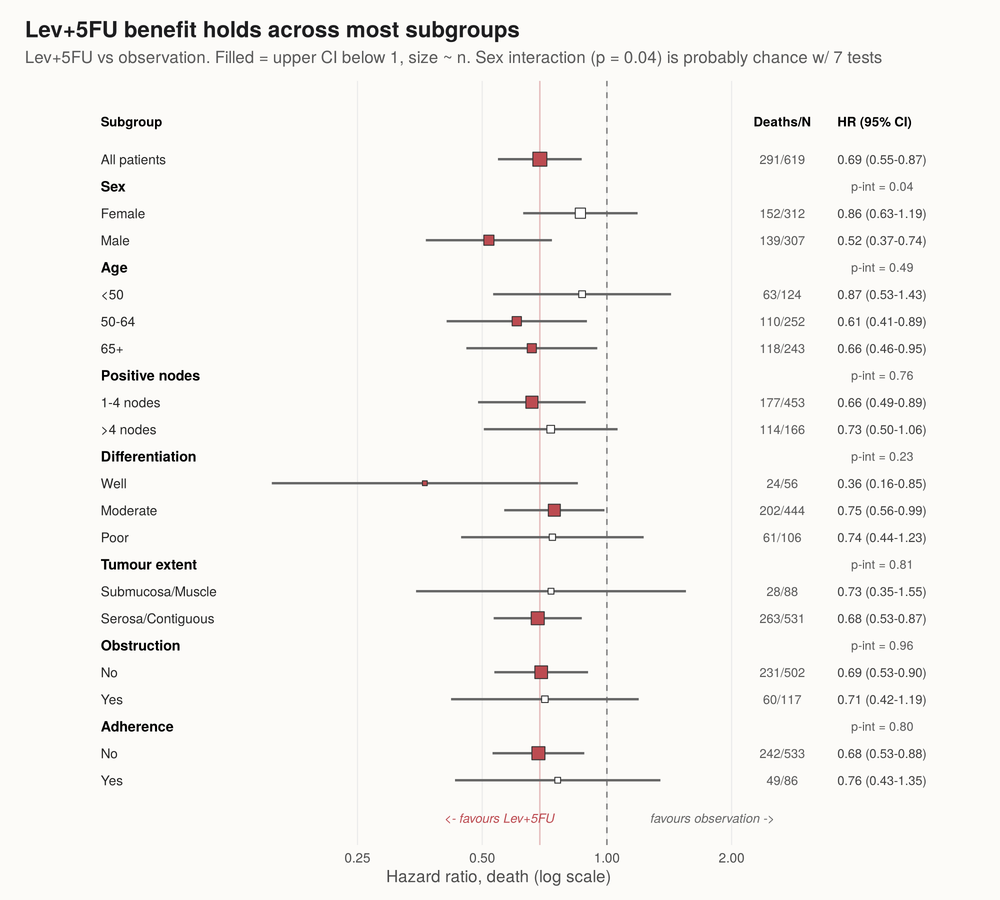
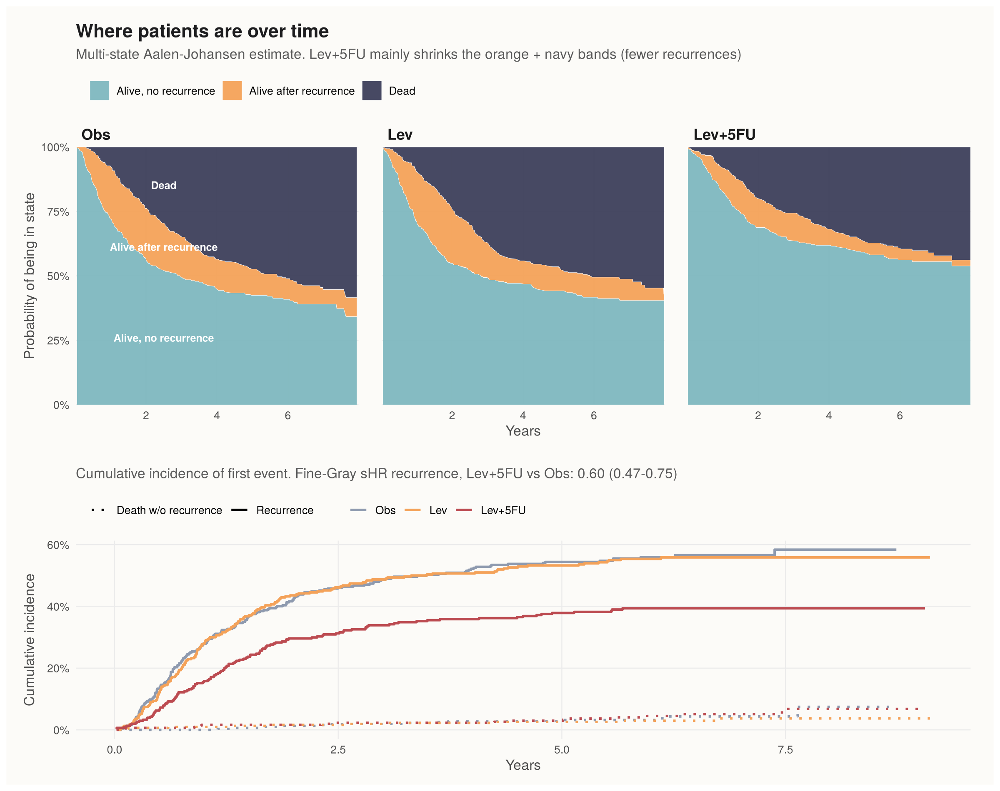
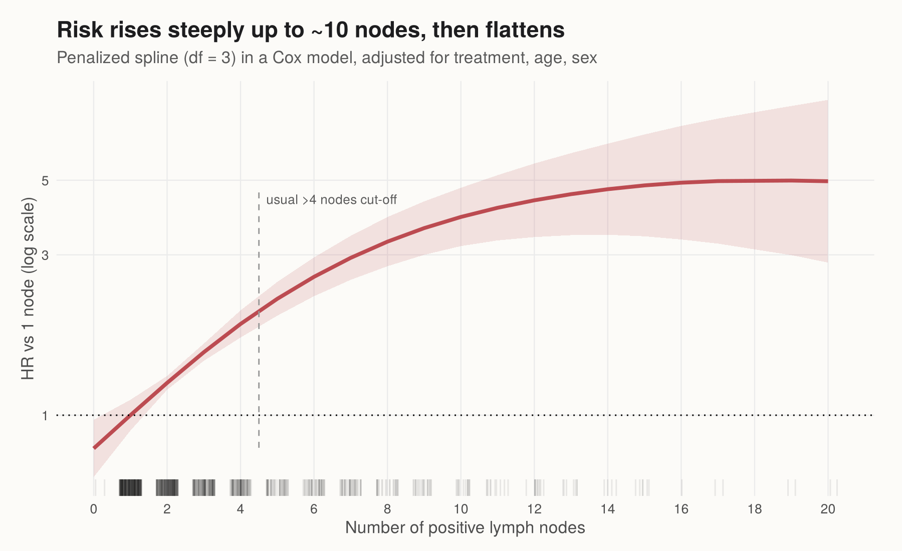

# Colon cancer adjuvant chemo - survival analysis in R

Re-analysis of the NCCTG / Intergroup trial of levamisole and levamisole + 5-FU after surgery for stage C colon cancer (Moertel et al., *NEJM* 1990). The data ships with the `survival` package as `colon`.

I wanted to go a bit further than a KM curve + one Cox model, so this covers:

- KM curves for overall survival with CIs, 5-yr estimates and a number-at-risk table (built by hand in ggplot + patchwork, not survminer)
- adjusted Cox model + PH checks (`cox.zph`)
- subgroup forest plot w/ interaction tests
- non-linear effect of positive lymph nodes (penalized spline)
- competing risks (recurrence vs death without recurrence) and a multi-state model to show the probability of being in each state over time

## Main results

| | HR for death vs observation (95% CI) |
|---|---|
| Lev | 0.97 (0.78-1.21) |
| Lev+5FU | 0.69 (0.55-0.87) |

- Adjusting for age, sex, nodes, differentiation, extent etc. gives basically the same Lev+5FU HR (0.69).
- 5-yr OS: 53% obs, 54% Lev, 63% Lev+5FU.
- The effect is mostly through fewer recurrences: Fine-Gray subdistribution HR for recurrence = 0.60 (0.47-0.75).
- Levamisole alone does nothing.









## How to run

```r
# R >= 4.1
install.packages(c("survival", "dplyr", "tidyr", "ggplot2", "patchwork", "ggrepel", "broom", "cmprsk", "forcats", "scales"))
source("run_all.R")
```

Figures go to `figures/`, tables to `output/`.

```
R/
  00_theme.R         shared ggplot theme + colours
  01_data_prep.R     2 rows/patient -> 1 row, recode factors, competing-risk outcome
  02_km.R            KM + risk table, OS vs RFS
  03_cox.R           Cox models, PH check, subgroup forest, nodes spline
  04_multistate.R    Aalen-Johansen CIF, Fine-Gray, multi-state state occupancy
```

## Notes / limitations

- The global PH test fails (p < 0.001), mostly because of differentiation and obstruction. The treatment term itself is fine (p = 0.26), and stratifying on differentiation gives the same treatment HR, so I left the main model as is.
- The sex interaction in the forest plot (p = 0.04) is one of 7 tests. I wouldn't read much into it.
- Complete case for the adjusted models (41 pts missing nodes or differentiation).
- TODO: restricted mean survival time (RMST) as a non-PH alternative; maybe a parametric (flexsurv) model to extrapolate.
